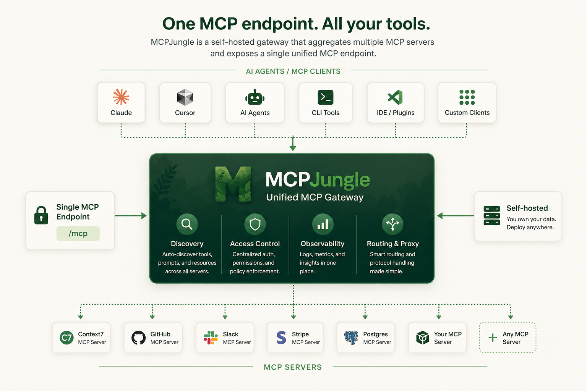
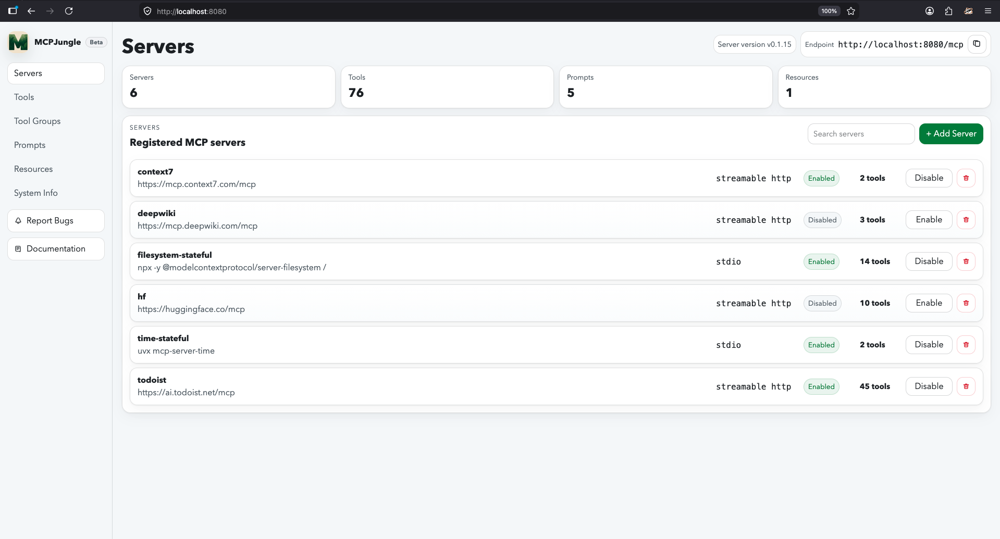
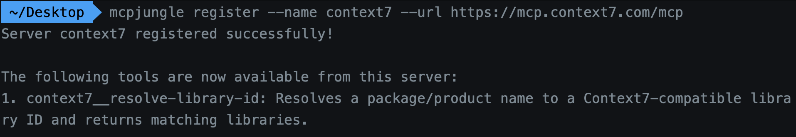
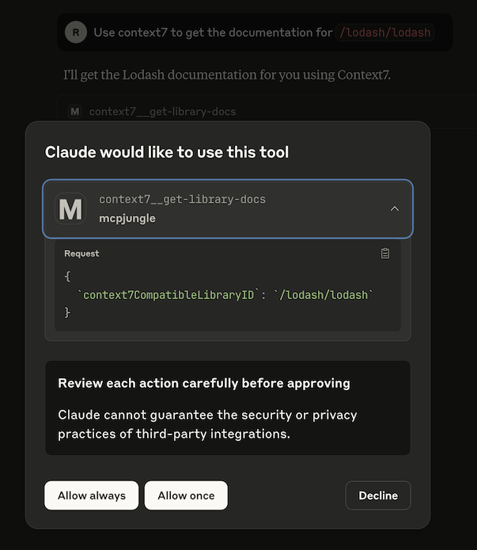

<h1 align="center">
  MCPJungle
</h1>
<p align="center">
  <strong>Run all your MCP servers behind one endpoint</strong>
</p>
<p align="center">
  <a href="https://docs.mcpjungle.com" style="text-decoration: none;">
    
  </a>

  <a href="https://github.com/mcpjungle/mcpjungle/pkgs/container/mcpjungle" style="text-decoration: none;">
    
  </a>

  <a href="https://discord.gg/CapV4Z3krk" style="text-decoration: none;">
    
  </a>
</p>

MCPJungle is a self-hosted MCP gateway for developers and teams who want to manage multiple MCP servers without scattered client configurations, duplicated setup, or inconsistent access control.

Use it **locally** to keep your personal MCP setup clean, or run it as **shared infrastructure** for a team with centralized discovery, access control, and observability.



Instead of wiring every MCP server into every AI client, register your servers once in MCPJungle and let Claude, Cursor, Codex, or your own Agents connect to a single MCP endpoint.

## Why MCPJungle?

MCP is powerful, but managing many MCP servers gets messy fast.

Without a gateway:

- 🔌 Every client needs its own MCP server configuration
- 🧩 Tools, prompts, and resources are scattered across different servers
- 🔐 Access control is duplicated or missing
- 👥 Teams have no shared view of available MCP tools
- 🛠️ Local setups become hard to reproduce

MCPJungle gives you a single control point:

- 🌐 One MCP endpoint for Claude, Cursor, Copilot, and custom agents
- 🗂️ One place to register and manage MCP servers
- 🔎 Unified discovery for tools, prompts, and resources
- 🎛️ Optional tool groups to expose only the tools a client should see
- 📊 Simple access-control and observability hooks for shared deployments

Start with a local setup. Scale to a shared team gateway when you need it.



## Documentation
 Mcpjungle documentation has a new home: [https://docs.mcpjungle.com](https://docs.mcpjungle.com).
 
 Please prefer the docs site over this README for the latest guides, reference, and operational details.
 
 Your AI Clients can also access the docs using its MCP server `https://docs.mcpjungle.com/mcp`!

## Quickstart

This quickstart guide will show you how to:
1. Start the mcpjungle server locally using `docker compose`
2. Add an MCP server in mcpjungle
3. Connect your Claude Desktop to mcpjungle to access your MCP tools

### Start the server
Fetch the `docker-compose.yaml` and start the mcpjungle server:
```bash
curl -O https://raw.githubusercontent.com/mcpjungle/MCPJungle/refs/heads/main/docker-compose.yaml
docker compose up -d
```

This exposes mcpjungle's streamable http mcp server at `http://localhost:8080/mcp` by default.

### Add an MCP server
1. Download the `mcpjungle` CLI on your local machine either using brew or directly from the [Releases Page](https://github.com/mcpjungle/MCPJungle/releases).
```bash
brew install mcpjungle/mcpjungle/mcpjungle
```

 2. Add the [context7](https://context7.com/) MCP server to mcpjungle using the CLI:
```bash
mcpjungle register --name context7 --url https://mcp.context7.com/mcp
```

You should see output similar to this:



### Connect to mcpjungle

In your Claude Desktop, add the configuration for mcpjungle MCP server:
```json
{
  "mcpServers": {
    "mcpjungle": {
      "command": "npx",
      "args": [
        "mcp-remote",
        "http://localhost:8080/mcp",
        "--allow-http"
      ]
    }
  }
}
```

Once you have added the configuration, try asking claude something simple: 
```text
Use context7 to get the documentation for `/lodash/lodash`
```

Claude will then attempt to call the `context7__get-library-docs` tool via MCPJungle, which will return the documentation for the Lodash library.

<p align="center">
  
</p>

You now have a working MCP setup with a single unified endpoint!

Next, explore the complete documentation at [docs.mcpjungle.com](https://docs.mcpjungle.com/) and the [public roadmap](https://docs.mcpjungle.com/roadmap).
